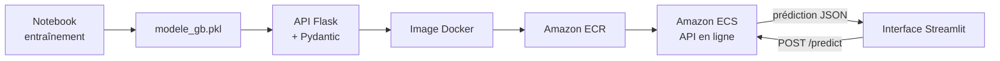

[README.md](https://github.com/user-attachments/files/34655707/README.md)
# Prédiction des frais d'assurance — du modèle ML au déploiement sur AWS

Projet de Machine Learning de bout en bout : un modèle qui estime les **frais médicaux d'un assuré** est exposé via une **API REST Flask**, conteneurisé avec **Docker**, déployé sur **AWS (ECR + ECS)** et utilisé depuis une **interface Streamlit**.


---

## Sommaire

- [Contexte](#contexte)
- [Architecture](#architecture)
- [Stack technique](#stack-technique)
- [Structure du projet](#structure-du-projet)
- [Résultats du modèle](#résultats-du-modèle)
- [Lancer le projet en local](#lancer-le-projet-en-local)
- [Utiliser l'API](#utiliser-lapi)
- [Déploiement sur AWS](#déploiement-sur-aws)
- [Interface Streamlit](#interface-streamlit)
- [Difficultés rencontrées](#difficultés-rencontrées)
- [Améliorations prévues](#améliorations-prévues)
- [Auteur](#auteur)

---

## Contexte

Une compagnie d'assurance souhaite estimer les frais médicaux annuels d'un client à partir de son profil.

- **Données** : jeu de données *Insurance* (Kaggle), 1 338 assurés
- **Variables d'entrée** : âge, IMC, sexe, statut fumeur, région
- **Cible** : frais médicaux (en $)
- **Modèle** : `GradientBoostingRegressor` (scikit-learn)

L'objectif du projet n'est pas seulement d'entraîner un modèle, mais de le **rendre utilisable** comme en entreprise : le modèle vit dans une API déployée dans le cloud, et l'interface ne fait que l'appeler.

---

## Architecture



---

## Stack technique

| Étape | Outils |
|---|---|
| Analyse et modélisation | Python, pandas, NumPy, scikit-learn, Jupyter |
| Sauvegarde du modèle | joblib |
| API | Flask, Pydantic (validation des entrées) |
| Conteneurisation | Docker |
| Cloud | AWS CLI, Amazon ECR, Amazon ECS |
| Interface | Streamlit, requests |

---

## Structure du projet

```
├── assurance/
│   ├── *.ipynb              # notebook : exploration, préparation, entraînement
│   └── insurance.csv        # données
├── main.py                  # API Flask (route /predict)
├── modele_gb.pkl            # modèle entraîné
├── app.py                   # interface Streamlit
├── requirements.txt         # dépendances (versions fixées)
├── Dockerfile               # image de l'API
├── .dockerignore
└── README.md
```

---

## Résultats du modèle

| Métrique (jeu de test) | Valeur |
|---|---|
| R² | _à compléter_ |
| MAE | _à compléter_ |
| RMSE | _à compléter_ |

Le statut **fumeur** est de loin la variable la plus influente, suivie de l'**IMC** et de l'**âge**.

---

## Lancer le projet en local

### 1. Cloner le dépôt et créer l'environnement

```bash
git clone https://github.com/ahmadoumoukhtark-cpu/Prediction-De-La-Charge-D-assurance-.git
cd Prediction-De-La-Charge-D-assurance-
python -m venv .venv
```

Activer l'environnement :

```powershell
# Windows (PowerShell)
Set-ExecutionPolicy -Scope Process -ExecutionPolicy RemoteSigned
.\.venv\Scripts\Activate.ps1
```

```bash
# Linux / macOS
source .venv/bin/activate
```

Installer les dépendances :

```bash
pip install -r requirements.txt
pip install streamlit requests
```

### 2. Lancer l'API

```bash
python main.py
```

L'API écoute sur `http://localhost:5000`.

### 3. Lancer avec Docker

```bash
docker build -t assurance-api .
docker run -p 5000:5000 assurance-api
```

---

## Utiliser l'API

**Route** : `POST /predict`

**Exemple de requête** :

```bash
curl -X POST http://localhost:5000/predict \
  -H "Content-Type: application/json" \
  -d '{"age": 35, "imc": 28.5, "sexe": "Homme", "fumeur": "Non", "region": "Sud-Est"}'
```

| Champ | Type | Valeurs possibles |
|---|---|---|
| `age` | entier | 18 à 64 |
| `imc` | décimal | ex. 28.5 |
| `sexe` | texte | `Homme`, `Femme` |
| `fumeur` | texte | `Oui`, `Non` |
| `region` | texte | `Nord-Est`, `Nord-Ouest`, `Sud-Est`, `Sud-Ouest` |

La réponse est un JSON contenant le montant estimé des frais.

---

## Déploiement sur AWS

### 1. Créer le registre et s'authentifier

```bash
aws configure set region eu-north-1
aws ecr create-repository --repository-name assurance-api
aws ecr get-login-password --region eu-north-1 | docker login --username AWS --password-stdin <ID_COMPTE>.dkr.ecr.eu-north-1.amazonaws.com
```

### 2. Construire, taguer et pousser l'image

```bash
docker build -t assurance-api .
docker tag assurance-api:latest <ID_COMPTE>.dkr.ecr.eu-north-1.amazonaws.com/assurance-api:latest
docker push <ID_COMPTE>.dkr.ecr.eu-north-1.amazonaws.com/assurance-api:latest
```

### 3. Déployer sur Amazon ECS

Dans la console AWS → **ECS** → créer un service à partir de l'image ECR (`:latest`), port conteneur **5000**. ECS fournit une URL publique pour l'API.

> Penser à supprimer le service ECS quand il n'est plus utilisé, pour éviter les frais.

---

## Interface Streamlit

L'interface envoie le profil du client à l'API déployée et affiche :

- le **coût estimé** de l'assurance ;
- la **comparaison** avec la moyenne du dataset (13 270 $) ;
- la **catégorie d'IMC** ;
- l'**importance des variables** du modèle ;
- le **détail de la requête** envoyée à l'API.

Pages disponibles : Prédiction, Analyse des données, Performance du modèle, À propos.

```bash
streamlit run app.py
```

Pour utiliser une autre URL d'API :

```powershell
$env:API_URL = "https://mon-api.exemple.com"
streamlit run app.py
```

<!-- Ajouter une capture d'écran :  -->

---

## Difficultés rencontrées

| Problème | Cause | Solution |
|---|---|---|
| Erreur 503 sur ECS | L'API écoutait sur `127.0.0.1` en mode debug | `app.run(host="0.0.0.0", port=5000, debug=False)` |
| Erreur au chargement du modèle | Version de scikit-learn différente | Version fixée (`scikit-learn==1.6.1`) |
| Échec de `docker login` sous Windows | Gestionnaire d'identifiants Docker | Configuration Docker dédiée (`DOCKER_CONFIG`) |
| Le service ECS gardait l'ancienne image | Image référencée par son digest | Utiliser le tag `:latest` et forcer un nouveau déploiement |
| Modules manquants (`click`, `cloudpickle`…) | Environnement virtuel incomplet | Réinstallation complète des dépendances |

---

## Améliorations prévues

- [ ] Pipeline **CI/CD** (GitHub Actions) : build et déploiement automatiques
- [ ] Suivi des expériences et des modèles avec **MLflow**
- [ ] **Monitoring** du modèle en production (logs, dérive des données)
- [ ] Déploiement de l'interface Streamlit dans le cloud
- [ ] Tests automatisés de l'API

---

## Auteur

**Ahmadou Moukhtar** — Étudiant en Master Ingénierie de l'IA

- LinkedIn : _[lien]_
- GitHub : [ahmadoumoukhtark-cpu](https://github.com/ahmadoumoukhtark-cpu)
